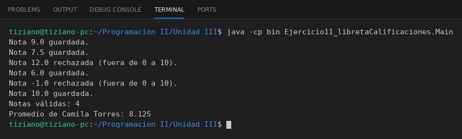

# LibretaCalificaciones

Programación II - Unidad 3 - Ejercicio 11

## Consigna
Modelar la clase aplicando encapsulamiento: atributos privados y métodos públicos que validan antes de modificar el estado. Una libreta digital con notas ocultas y promedio.

## Lógica
- Lista privada de notas y nombre del estudiante.
- `agregarNota(nota)` valida el rango de 0 a 10 (10 incluido).
- `obtenerPromedio()` calcula internamente sin exponer la estructura.
- `Main` registra notas válidas e inválidas.

## Ejecución

